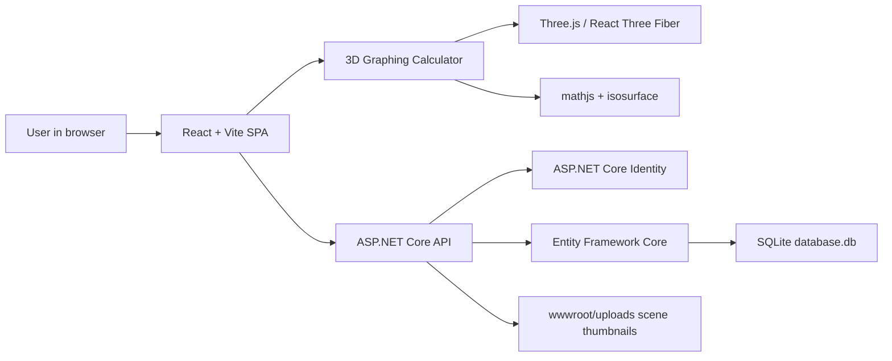

# Thesis Overview

## Abstract

This project implements **Graphing**,  a web-based social platform centered around mathematical 3D graph scenes. Unlike conventional social media applications, where posts contain text, photographs, or videos, the primary content unit here is an interactive graphing scene. A scene is composed of explicit, implicit, and parametric surfaces, rendered in a browser-based 3D editor. Users can save private scenes, publish scene versions as posts, comment on and like posts, report inappropriate content, and open another user's posted scene in the editor as their own editable copy.

The application therefore joins two domains: a browser graphing calculator and a social publishing system. The graphing calculator provides mathematical expression parsing, surface mesh generation, camera-aware rendering, scene serialization, and thumbnail capture. The website layer provides authentication, scene persistence, post feeds, comments, likes, reporting, banning, and administrative moderation tools.

## Problem Statement

Mathematical visualization tools often exist as isolated editors: they allow users to construct and inspect graphs, but they rarely provide a community model for sharing, discussing, moderating, and reusing graph constructions. Social platforms, on the other hand, usually treat visual media as static artifacts. This project addresses the gap by treating a 3D mathematical scene as both an editable object and a social object.

## Objectives

The project aims to:

1. Provide a usable browser-based 3D graphing calculator for explicit, implicit, and parametric surfaces.
2. Persist graphing scenes as structured snapshots containing equations and camera state.
3. Version saved scenes so that published posts refer to stable scene states.
4. Allow users to publish saved scene versions as posts in a feed.
5. Support social interaction through likes and comments.
6. Allow users to load scenes from posts and continue editing them as separate copies.
7. Provide moderation tools for reporting content, reviewing reports, banning users, and unbanning users.
8. Use a modern full-stack architecture based on ASP.NET Core, React, and a relational database.

## System Architecture

At a high level, the system has three layers:

- Client application: a React/Vite single-page application that renders pages, manages authentication state, calls the API, and hosts the 3D graphing calculator.
- Server application: an ASP.NET Core API that handles authentication, scenes, posts, comments, likes, reports, bans, and static asset serving.
- Persistence layer: an SQLite database accessed through Entity Framework Core and ASP.NET Identity.

## Main Contribution

The core contribution is the integration of graph state, social state, and moderation state into one coherent application. The graph editor is not merely embedded as a visual widget; it defines the central data model of the application. A graph scene can be drafted locally, saved privately, versioned, published publicly, discussed, liked, reported, and reopened into the calculator for further work.

The implementation uses immutable scene versions for published posts. This is an important design choice: a post does not point directly to the latest editable scene. Instead, it points to a `GraphSceneVersion`, preserving the exact mathematical surface definitions and camera view that were published.

## Main User Roles

The system distinguishes between:

- Guest users, who can view the landing editor but cannot persist or interact with social data.
- Authenticated users, who can save scenes, publish posts, like and comment on posts, report other users' content, and load scenes from posts.
- Admin users, who can access moderation pages, triage reports, ban users, unban users, and see content involving banned users.

## Key Entities

The main domain entities are:

- `ApplicationUser`: an Identity user extended with display name and ban status.
- `GraphScene`: the user's current editable scene record.
- `GraphSceneVersion`: an immutable saved version of a scene.
- `Post`: a social publication of a scene version.
- `Comment`: a discussion entry under a post.
- `PostLike`: a unique like relation between user and post.
- `Report`: a moderation report targeting a post or comment.
- `Ban`: an administrative ban record linked to a user and optionally to a source report.

## Development and Runtime Model

The server is configured as the host application. During development, the ASP.NET project references the React client project through SPA proxy configuration. Vite serves the client over HTTPS and proxies `/api`, `/uploads`, and `/public` traffic to the ASP.NET backend. In production-style hosting, ASP.NET serves static files and falls back to `index.html` for client-side routes.

The application also sets `Cross-Origin-Embedder-Policy` and `Cross-Origin-Opener-Policy` headers on both backend and Vite dev server responses. This makes the browser environment more suitable for advanced rendering and shared-resource isolation.

## More details

For more details, see the [paper](paper/thesis.pdf) associated with the thesis.
